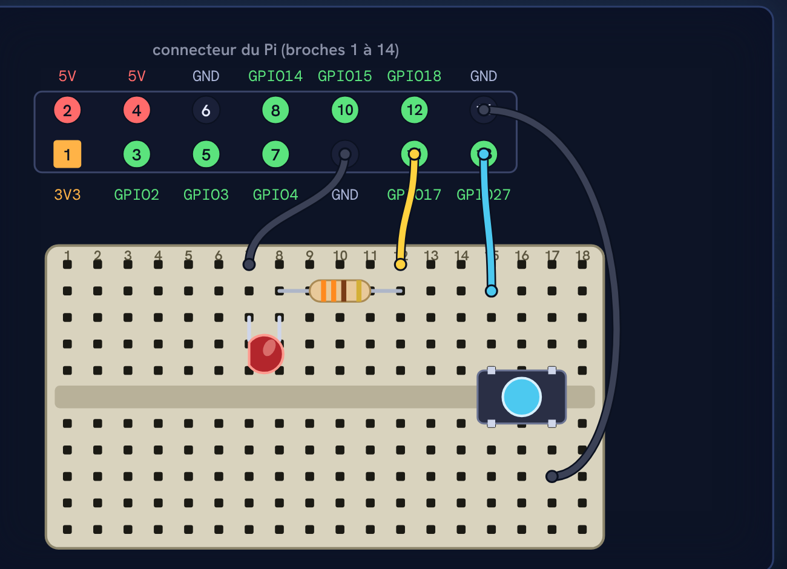
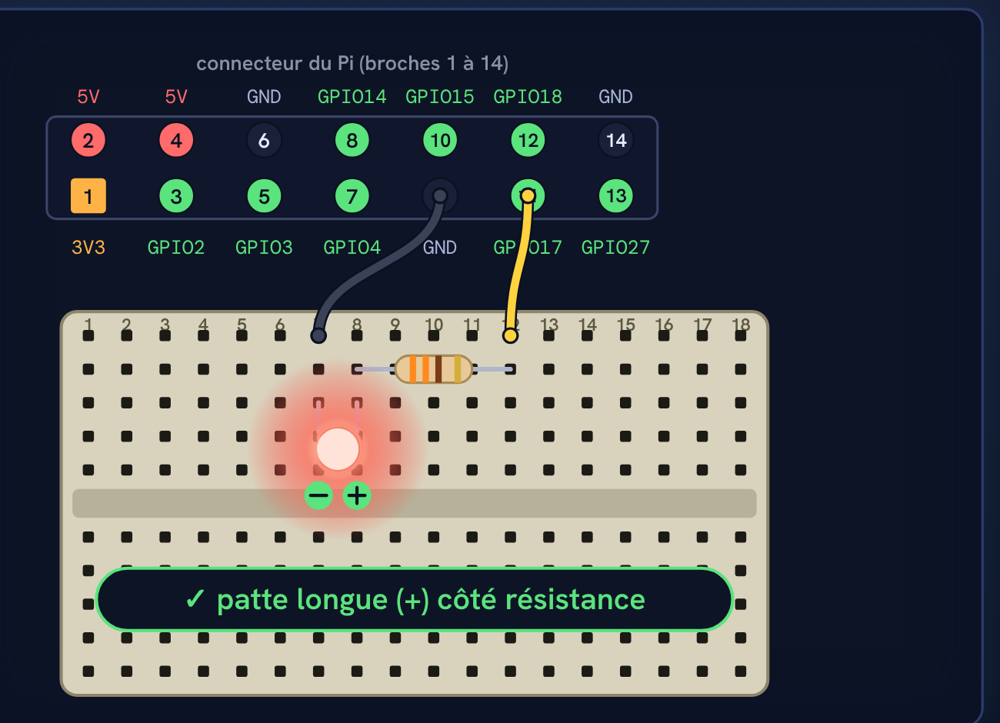
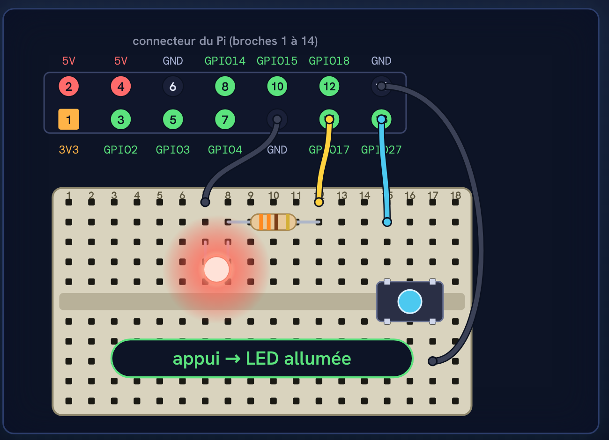

# Tutoriel Raspberry Pi n°3 : une LED, puis un bouton, avec les GPIO du Raspberry Pi 4

Les programmes de la vidéo, à copier. Il te faut un Raspberry Pi 4 accessible en SSH (voir les tutoriels n°1, `raspberry-pi-4-demarrage-headless`, et n°2, `raspberry-pi-4-serveur-web`).

**Niveau de validation** : les quatre programmes ont été exécutés avec le simulateur de broches de `gpiozero` (`GPIOZERO_PIN_FACTORY=mock`) : l'appui sur le bouton allume la LED, le relâchement l'éteint, `toggle` bascule, `blink` fait clignoter. Le tutoriel **n'a pas été essayé sur un vrai Raspberry Pi ni avec de vrais composants** : le montage est un schéma fait pour la vidéo. Le brochage suit le schéma officiel du Raspberry Pi 4 : broche 11 = GPIO17, broche 13 = GPIO27, broches 9 et 14 = GND (masse).

## Le montage



| Fil | De | Vers |
|---|---|---|
| jaune | broche 11 du Pi (GPIO17) | colonne 12 de la platine, avec la résistance |
| noir | colonne 7 de la platine (cathode de la LED) | broche 9 du Pi (GND) |
| bleu | broche 13 du Pi (GPIO27) | colonne 15, moitié haute (bouton) |
| noir | broche 14 du Pi (GND) | colonne 17, moitié basse (bouton) |

Chemin du courant de la LED : GPIO17 → résistance 330 Ω → LED (patte longue côté résistance) → GND. **Éteindre le Pi (`sudo shutdown -h now`) avant de câbler. Jamais de 5 V sur une broche GPIO.**

## 1. Faire clignoter la LED

```bash
sudo apt install python3-gpiozero -y   # normalement déjà installé
nano led.py
python3 led.py
```

Contenu : [`led.py`](led.py) (enregistrer : Ctrl + O, Entrée ; quitter : Ctrl + X ; arrêter le programme : Ctrl + C).

Pièges de la vidéo :
- **`LED(11)`** : rien ne s'allume et aucune erreur. 11 est la position de la broche sur le connecteur ; le code utilise le numéro GPIO : `LED(17)`.
- **LED à l'envers** : toujours rien. La patte longue (+) doit être du côté de la résistance, la courte (−) du côté de la masse.



## 2. Allumer la LED avec le bouton

```bash
nano bouton.py
python3 bouton.py
```

Contenu : [`bouton.py`](bouton.py).

Piège de la vidéo : sans la dernière ligne `pause()` (et `from signal import pause`), le programme arrive à la fin et s'arrête tout de suite : appuyer ne fait rien.



## 3. Variantes

- [`bouton_toggle.py`](bouton_toggle.py) : un appui allume, l'appui suivant éteint (`led.toggle`).
- [`blink.py`](blink.py) : `led.blink()` fait clignoter la LED toute seule, sans boucle.

## Matériel

Un Raspberry Pi 4 accessible en SSH, une platine d'essai, une LED, une résistance de 330 Ω, un bouton poussoir, quatre fils de connexion femelle-mâle.
